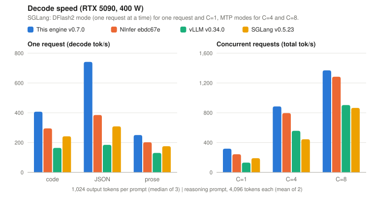
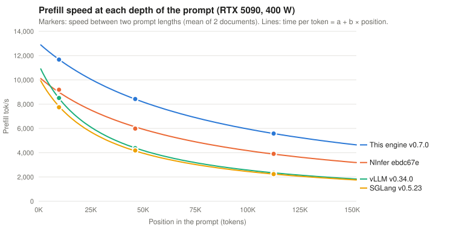

# Benchmarks

Speed and quality of the default configuration (`docker compose up -d serve` with no settings changed: weights
`gdnfp4`, KV cache `nvfp4`, DSpine speculative decoding, `MAX_SEQS=8`, `MAX_TOKENS=262144`), and how to reproduce
each number. The JSON files of the speed numbers are in [results/](results/).

Every speed number through the server, the in-process table by context length and the comparison with other engines
were measured on the same day (2026-11-23) with v0.7.0, DSpine and DFlash2 (`SPEC=dflash2`) on the same build, and the
other engines in their latest releases. The video and power limit sections keep their own dates.

## Conditions

| | |
| --- | --- |
| GPU | RTX 5090 (32 GB), power limit **400 W** (below the card's default 575 W; every number here is at 400 W) |
| Host | WSL2 (kernel 6.18), Docker with the NVIDIA Container Toolkit, NVIDIA driver 621.01 |
| Build | v0.7.0, the serving image (CUDA 13.3), `ghcr.io/mkyt/qwen3-27b-5090:0.7.0` (`328ea56`); the one-request decode and concurrent rows were taken on `2f0e0c3`, the same engine before two CI-only commits |
| Date | 2026-11-23 |

Prefill is power-bound at 400 W: the FP4 / FP8 GEMMs and attention all run at the power limit. The card's default
575 W limit and the energy per token at both limits are in [Power limit and energy](#power-limit-and-energy).

## Speed

### One request

Through the server (`scripts/bench_agentic.py --scenarios decode`): three short prompts, 1,024 output tokens, the
checkpoint's default sampling (temperature 1.0, top-k 20, top-p 0.95), thinking off, three runs each. Decode tok/s is
(tokens - 1) / (time of the last token - time of the first).

| Prompt | DSpine (default), decode tok/s, median (range) | DFlash2 | DSpine / DFlash2 (median) |
| --- | ---: | ---: | ---: |
| code | 407 (400–422) | 365 (361–491) | 1.12 |
| JSON | 742 (721–749) | 485 (482–518) | 1.53 |
| prose | 250 (248–254) | 273 (259–280) | 0.92 |

The speed depends on how many draft tokens are accepted, which depends on the text: structured output goes faster
than prose. DSpine drafts blocks of 16 tokens and verifies 16 or 8 rows depending on how many it has been getting
accepted, so it gains most where long runs of tokens are predictable (JSON, code); on prose DFlash2 is a little
faster. Without speculative decoding (`SPEC=none`) one request decodes at about 93 tok/s at a 19K-token context.

### Prefill and decode by context length

In-process, one request, no speculative decoding (`scripts/bench_decode.py`). Prefill is the best of two cold runs
after a warm-up; decode is the median of 64 greedy steps after the prefill. The context is the longest golden prompt
(Japanese prose) repeated.

| Context | Prefill tok/s | Prefill time | Decode tok/s |
| ---: | ---: | ---: | ---: |
| 19,000 | 12,170 | 1.56 s | 93.0 |
| 73,000 | 9,272 | 7.87 s | 87.0 |
| 194,000 | 6,149 | 31.6 s | 76.7 |

### Concurrent requests

Through the server (`scripts/bench_concurrent.py`): C requests start together on the same reasoning prompt with
distinct seeds, 4,096 output tokens each, the default sampling. "Sum" adds each stream's own decode rate; "wall"
divides all output tokens by the time from the start to the last response. Two runs each.

| C | Sum tok/s | Per request (p50) | Wall tok/s | DFlash2, sum tok/s |
| ---: | ---: | ---: | ---: | ---: |
| 1 | 318 | 318 | 316–317 | 323 |
| 4 | 872–899 | 216–222 | 839–859 | 920–923 |
| 8 | 1,339–1,399 | 168–171 | 1,242–1,277 | 1,364–1,368 |

All C requests run as one batch, and each request's tokens are bit-identical to running it alone. With DFlash2 every
request verifies 8 rows per step; with DSpine each request verifies 4, 8, 12 or 16 rows of its own, chosen from the
tokens it has been getting accepted at each width and a model of the step's time (`Q27_SPEC_ADAPT_BATCH`,
[configuration.md](configuration.md)). On this reasoning prompt wider blocks hardly raise the acceptance, so DSpine
keeps most requests at 8 rows and accepts fewer of them than DFlash2. Since v0.7.0 each request then verifies only the
prefix of its draft that is worth its time, judged from the draft's own confidence before any token is drawn
(`Q27_SPEC_CUT`), which made four and eight requests 2.5% and 2.7% faster here; DFlash2 is still 3–6% faster with four
requests, and the two are level with eight. With one request this prompt is a single fixed-seed text, so its rate moves
with any change of the numerics that changes the text: over eight seeds one request runs within about ±7% of the
mean. The per-request rows pay off when the requests differ or produce predictable text: in-process,
greedy (`scripts/batch_test.py bench --temperature 0`), against 8 rows each, four and eight mixed requests (code, JSON,
prose, Japanese) are 9% and 4% faster and four code requests 21% faster. `SPEC=dflash2` remains a choice for a server
that mostly runs many requests of long prose or reasoning at once.

### Agent sessions and long documents

Through the server (`scripts/bench_agentic.py --scenarios agent,longctx`).

- **agent**: sessions that share a 4,000-token system prompt and 20 tools, each running 8 turns of tool calls with
  800–3,000-token tool results (the history grows to about 20K tokens). One session: time to the first token of a
  later turn 0.21 s (p50), decode 352 tok/s (DFlash2 313), prefix cache hit rate 84% of the prompt tokens, 99.6% of
  the ones that can be reused. Four at once: 0.24 s, 160 tok/s each (DFlash2 193), 98.5% of the reusable tokens. The
  turns differ between runs (the model decides when to call tools), so the decode rates are rough.
- **longctx**: a long unique document, then a follow-up question on it. 19.5K tokens: first token after 1.65 s cold,
  0.05 s for the follow-up. 73K tokens: 7.92 s cold, 0.17 s for the follow-up.

### Video input

A 60-second video at 30 fps is sampled to 120 frames (60 pairs, 11,400 tokens at 608 x 320); the engine decodes it
on NVDEC and resizes the sampled frames on the GPU ([results/20261115-video-decode.json](results/20261115-video-decode.json);
FFmpeg's CPU decoder and RGB conversion through PyAV, `pyav_cpu` in
[results/20261115-video-decode-cpu.json](results/20261115-video-decode-cpu.json)):

| Video | 2 decoders | 1 decoder | FFmpeg on 24 CPU threads (PyAV) |
| --- | ---: | ---: | ---: |
| 4K AV1 10-bit, 160 MB | 2.55 s | 4.17 s | 8.98 s (43 s of CPU time) |
| 4K HEVC 10-bit, 227 MB | 2.00 s | 3.36 s | 6.61 s (51 s) |
| 1080p H.264, 160 MB | 1.07 s | 1.47 s | 1.28 s (15 s) |

Through the API, the 4K AV1 video with a question takes 5.3 to 5.7 s to the first token (decode, vision tower,
prefill); asking about it again with another question takes 1.8 s, since only the pair the prefix cache does not
hold is decoded and encoded. While a video decodes, the KV pool lends the decoder's memory (about 1 GiB for 4K on
two decoders) and takes it back afterwards: the process never goes past its VRAM budget, and the KV cache holds as
many tokens as without video support.

On video prompts the engine is as close to the reference model as on images: on the text after the video, top-1
agreement 95 to 100% and mean KL 0.01 to 0.10 ([results/20261115-video-golden.txt](results/20261115-video-golden.txt)).
The timestamp text between the frame pairs is far more sensitive: there the reference model differs from itself by as
much when only its vision embeddings are the engine's.

### KV cache capacity

The KV pool holds 601,856 tokens with the defaults (605,504 with `SPEC=dflash2`: DSpine's tables take 0.25 GiB more) (the server log prints the memory plan at startup). One request can
use the full 262,144-token context; the scheduler admits a new request only when the free KV cache can hold its prompt
plus 4,096 output tokens, so eight long requests wait in line instead of evicting each other.

### Reproduce

```bash
docker compose up -d serve
uv run scripts/bench_agentic.py --label decode --scenarios decode --decode-reps 3
uv run scripts/bench_concurrent.py --label concurrent --prompts reason --concurrency 1,4,8 --max-tokens 4096 --reps 2 \
  --extra-body '{"temperature":1.0,"top_p":0.95,"top_k":20,"presence_penalty":0}'
uv run scripts/bench_agentic.py --label agent --scenarios agent,longctx
uv run scripts/bench_agentic.py --label prefill-s0 --seed 0 --scenarios longctx --longctx-tokens 32000,120000,250000
SPEC=dflash2 docker compose up -d serve   # the DFlash2 columns: the first three commands again
docker compose stop serve
docker compose --profile dev run --rm dev python scripts/bench_decode.py --weights gdnfp4 --kv-dtype nvfp4 \
  --ctx 19000,73000,194000 --tokens 64 --prefill-reps 2
```

The results go to `bench/results/`. The runs above are [results/](results/) `20261123-*-dspine-v070-*.json`
(DSpine), `20261123-*-dflash2-v070-*.json` (DFlash2) and
[results/20261123-v070-prefill-decode.json](results/20261123-v070-prefill-decode.json) (by context length).

### Other engines

The same scripts against each engine's latest release and its own serving setup, on the same day (2026-11-23), GPU,
driver and 400 W limit, one engine at a time, with the sampling pinned for all of them
(`--extra-body '{"temperature":1.0,"top_p":0.95,"top_k":20,"presence_penalty":0}'`). Each engine runs its own
weights and KV cache type. SGLang needs different settings for different scenarios because one configuration cannot do
everything; the settings are listed below the table. The other engines' settings are working configurations for this
card, not the largest each could start.

| | This engine v0.7.0, DSpine (default) | This engine v0.7.0, DFlash2 | [NInfer](https://github.com/Neroued/ninfer) `ebdc67e` | [SGLang](https://github.com/sgl-project/sglang) v0.5.23 | [vLLM](https://github.com/vllm-project/vllm) v0.34.0 |
| --- | ---: | ---: | ---: | ---: | ---: |
| Context limit / KV cache, tokens | 262,144 / 601,856 | 262,144 / 605,504 | 131,072 / about 220,000 | 90,000 / 98,134 (fast), 196,608 / 214,219 (agent), 160,000 / 172,825 (parallel) | 160,000 / 169,491 |
| Decode, one request, code / JSON / prose (tok/s) | **407 / 742** / 250 | 365 / 485 / **273** | 295 / 385 / 202 | 242 / 309 / 176 (fast) | 164 / 185 / 131 |
| Concurrent, sum at C=1 (tok/s) | 318 | **323** | 243–244 | 183–198 (fast) | 131 |
| Concurrent, sum at C=4 | 872–899 | **920–923** | 792–799 | 443–446 (agent) | 558 |
| Concurrent, sum at C=8 | 1,339–1,399 | 1,364–1,368 | 1,272–1,296 | 861–869 (parallel) | 901–906 |
| Agent turn, time to first token, 1 / 4 sessions (p50) | **0.21** / 0.24 s | **0.21 / 0.23 s** | 0.27 / 0.56 s | 0.39 / 0.39 s (agent; 0.26 s for one session in fast) | 0.41 / 0.78 s |
| A second question on a 19.5K / 73K-token document, time to first token | **0.05 / 0.17 s** | **0.05 / 0.17 s** | 0.47 / 1.55 s | 0.23 / 0.51 s (agent) | 0.15 / 0.43 s |

<picture>
  <source media="(prefers-color-scheme: dark)" srcset="images/decode-dark.svg">
  
</picture>

Decode is the median of three runs; the concurrent sums are two runs; prefill is below. The figure is drawn by `scripts/plot_decode.py` from the same files. The agent scenario's turns
differ in length between engines (the model decides when to call tools), so only the time to the first token of a
later turn is compared.

#### Prefill

A long document that is not in any cache (`scripts/bench_agentic.py --scenarios longctx --longctx-tokens
32000,120000,250000`, seeds 0 and 1, two different documents), through the server. The first three rows are the usual
measure: prompt tokens divided by the time to the first token, an average over the whole prompt. Because attention
grows with the position, the speed at a given depth is lower; the second set of rows gives the speed between two
lengths, (difference in tokens) / (difference in time), the mean of the two seeds.

| Prompt tokens | This engine v0.7.0, DSpine | This engine v0.7.0, DFlash2 | NInfer `ebdc67e` | SGLang v0.5.23 | vLLM v0.34.0 |
| --- | ---: | ---: | ---: | ---: | ---: |
| 19.5K, average tok/s (time to first token) | **11,670–11,671** (1.67 s) | 11,518–11,552 (1.69 s) | 8,717–9,661 (2.02–2.24 s) | 7,725–7,764 (2.52 s) | 8,499–8,523 (2.29 s) |
| 73K | **9,067–9,135** (7.99–8.04 s) | 9,015–9,023 (8.09 s) | 6,202–7,000 (10.42–11.76 s) | 4,763–4,777 (15.26–15.32 s) | 5,025–5,042 (14.46–14.52 s) |
| 152K | **6,843–6,861** (22.2 s) | 6,764–6,810 (22.3–22.5 s) | 4,786–4,921 (30.9–31.8 s) | 2,994–3,014 (50.4–50.8 s) | 3,150–3,158 (48.1–48.2 s) |
| 0 → 19.5K, tok/s in the interval | **11,670** | 11,535 | 9,189 | 7,744 | 8,511 |
| 19.5K → 73K | **8,425** | 8,354 | 5,986 | 4,184 | 4,381 |
| 73K → 152K | **5,579** | 5,525 | 3,907 | 2,239 | 2,346 |

<picture>
  <source media="(prefers-color-scheme: dark)" srcset="images/prefill-depth-dark.svg">
  
</picture>

The time per prompt token grows in a straight line with the position in every engine. Fitting it as a + b ×
position (from the three intervals above, at their middle positions; `scripts/plot_prefill_depth.py` draws the
figure) separates the part that does not depend on the depth, mostly the GEMMs, from attention, which grows with it:

| | This engine v0.7.0, DSpine | NInfer `ebdc67e` | vLLM v0.34.0 | SGLang v0.5.23 |
| --- | ---: | ---: | ---: | ---: |
| a: per token at any depth (µs) | **76.7** | 97.5 | 88.7 | 97.7 |
| b: added per 1K tokens of position (µs) | **0.91** | 1.42 | 3.00 | 3.10 |
| 73K → 152K against 0 → 19.5K | **48%** | 43% | 28% | 29% |

So this engine is 1.3–1.5x faster than the others over the first 19.5K tokens, where the a term weighs most, and
1.4–2.5x between 73K and 152K, where attention (the b term) dominates.

The settings are those in the table below, except NInfer, which ran with one request and a 196,608-token context
for these runs (the 152K prompt does not fit its 131,072-token setting; with that setting 19.5K and 73K took 2.11–2.12
and 10.87–10.90 s). The time to the first token includes HTTP, tokenization, the draft model's pass over the prompt
and the first decode step.

| Engine | Version | Weights | KV cache | Speculative decoding | Settings |
| --- | --- | --- | --- | --- | --- |
| This engine | v0.7.0 | `gdnfp4` | NVFP4 | DSpine, 16-token blocks (adaptive verify rows) / DFlash2, 8-token blocks | defaults (`MAX_SEQS=8`) |
| [NInfer](https://github.com/Neroued/ninfer) | [`ebdc67e`](https://github.com/Neroued/ninfer/commit/ebdc67e5) (2026-11-16), built on this repository's `dev` image (CUDA 13.3) | `neroued/Qwen3.8-27B-nvfp4-NInfer` | FP8 | DFlash2, 7 draft tokens, `--proposal-head optimized` | `--max-context 131072 --max-concurrency 8` (prefill: `--max-context 196608 --max-concurrency 1`) |
| [SGLang](https://github.com/sgl-project/sglang) | [v0.5.23](https://github.com/sgl-project/sglang/releases/tag/v0.5.23) with two unmerged patches: embedding in host memory ([#37826](https://github.com/sgl-project/sglang/pull/37826), backported) and MTP weight sharing ([#37155](https://github.com/sgl-project/sglang/pull/37155)) | `nvidia/Qwen3.8-27B-NVFP4` | FP8 | fast: DFlash2 (one request at a time); agent / parallel: the checkpoint's MTP head, 5 steps | fast: 90K, 1 request (decode, C=1, one agent session); agent: 196K, 4 requests (C=4, agent, documents, prefill); parallel: 160K, 8 requests (C=8) |
| [vLLM](https://github.com/vllm-project/vllm) | [v0.34.0](https://github.com/vllm-project/vllm/releases/tag/v0.34.0) | `nvidia/Qwen3.8-27B-NVFP4` | FP8 | MTP, 3 tokens | 160K, 8 requests, a fixed 6.5 GiB KV cache |

The JSON files are in [results/](results/): this engine `20261123-*-{dspine,dflash2}-v070-*.json`, NInfer
`20261123-*-ninfer-ebdc67e-*.json`, SGLang `20261123-*-sglang-0523-*.json`, vLLM `20261123-*-vllm-0340-*.json`. Notes:

- NInfer prints its KV cache as an estimate at startup (KV and recurrent state share one pool). It sizes its memory
  from what `cudaMemGetInfo` reports free; under WSL2 that left 7.7 GiB for KV and state with this setting, and it keeps a
  further 9.5 GiB of pinned host memory for its context cache.
- SGLang's DFlash2 mode spends about 5 GB on the draft model and per-request verification states, so it serves one
  request at a time with a 90K context.
- `gdnfp4` also runs on vLLM (`scripts/export_gdnfp4.py` writes a checkpoint it reads); the measurements above use
  NVIDIA's checkpoint, which is what vLLM and SGLang serve by default.

## Power limit and energy

The same scripts at 400 W and at the card's default 575 W, on the same day (2026-10-27) and the same code (`1b1b430`),
serving with the defaults. The energy is the whole board's, read from NVML's cumulative energy counter before and after
each request (`scripts/bench_energy.py`), so it includes the idle power (about 30 W) during the request.

| | 575 W | 400 W | 400 W vs 575 W |
| --- | ---: | ---: | --- |
| Decode, one request, code / JSON / prose (tok/s, median) | 391 / 507 / 263 | 386 / 500 / 259 | 1–2% slower |
| Concurrent, sum at C=1 / 4 / 8 (tok/s) | 319 / 1,020 / 1,546 | 313 / 939 / 1,403 | 2 / 8 / 9% slower |
| Time to first token, 19.5K / 73K-token document | 1.48 / 7.04 s | 1.86 / 8.71 s | 20% slower |
| Board power: decode / C=8 / prefill (W) | 420–456 / 564 / 570 | 374–408 / 402 / 390–396 | |
| Energy, decode code / JSON / prose (tok/J) | 0.72–0.88 / 1.09–1.14 / 0.58–0.59 | 0.80–0.95 / 1.22 / 0.63–0.66 | 8–13% more tokens per joule |
| Energy, concurrent C=1 / 4 / 8 (tok/J) | 0.62 / 1.68 / 2.45 | 0.70 / 2.14 / 3.15 | 13 / 27 / 29% more |
| Energy, prefill of 11.9K / 44.4K tokens (prompt tok/J) | 23.3 / 20.5 | 27.1 / 23.6 | 15–16% more |

Decode of one request draws 420–456 W even when it may draw 575 W, so the 400 W limit barely slows it. Prefill and
many concurrent requests use whatever the limit allows: 575 W buys 9–26% more speed for 40% more power. At 575 W the
board peaked at 580 W and 81 °C. The energy rows of the concurrent requests are one run of 2,048 tokens per stream,
timed until the last stream ends, so their tok/s is below the rows above (4,096 tokens, decoding streams only).

```bash
uv run scripts/bench_energy.py --label energy
```

The runs are [results/](results/) `20261027-*-pl575-*.json` and `20261027-*-pl400-*.json`.

## Quality

### Next-token distributions (golden)

Teacher forcing over 13 prompts, 35,328 positions (Japanese and English prose, Python and C++; `bench/golden/`).
Each recording keeps the top-20 next-token distribution at every position; two recordings are compared by top-1
agreement and KL divergence. The NVFP4 lm_head takes its activations in two terms since 2026-11-23 (W4A4x2; one
term before, still `Q27_LM_HEAD_A4X2=0`): [results/20261123-pq21-lm-head.json](results/20261123-pq21-lm-head.json).

| Compared | Top-1, two terms (default) | KL | Top-1, one term | KL |
| --- | ---: | ---: | ---: | ---: |
| Engine vs reference model (NVIDIA's checkpoint, KV bf16) | 90.8% | 0.0278 | 89.2% | 0.0366 |
| NVIDIA's checkpoint vs the BF16 original (reference model) | 89.8% | 0.0322 | 88.7% | 0.0361 |
| Engine, default (`gdnfp4`, KV nvfp4) vs the BF16 original | 87.9% | 0.0426 | 87.1% | 0.0467 |
| Engine, `nvidia`, KV nvfp4 vs the BF16 original | 89.4% | 0.0343 | 88.2% | 0.0383 |
| Engine, `quasar`, KV nvfp4 vs the BF16 original | 87.7% | 0.0462 | 86.8% | 0.0500 |

The noise floor of W4A4 rounding, the reference model with a BF16 against an FP8 KV cache, is 89.1% / 0.0359 (one
term). With the FP8 KV cache, measured on 2026-10-11 with one term
([results/20261011-pr2-golden-v2.json](results/20261011-pr2-golden-v2.json)): `gdnfp4` 87.6% / 0.0445, `nvidia`
88.7% / 0.0362 and `quasar` 87.2% / 0.0475 against the BF16 original.

The engine is no further from the reference model than the reference model is from itself with another KV cache
type, so the kernels compute the model correctly; what remains against the BF16 original is the quantization of the
weights, the activations and the KV cache.

**code-cpp overlaps `gdnfp4`'s calibration text** (83.7% of code-cpp-4096 in runs of 32 tokens), which flatters
`gdnfp4` against the other checkpoints. Without code-cpp (30,592 positions) the default is at 87.1% / 0.0445 and
`nvidia` at 88.8% / 0.0351.

### Tasks

The default configuration through the server (thinking off, greedy unless noted):

| Task | Result | Script |
| --- | --- | --- |
| GSM8K (300 fixed questions) | 95.0% | `quality_gsm8k.py` |
| BFCL v3 non-live AST (simple, multiple, parallel, parallel_multiple; 1,000 questions) | 89.0% | `quality_tools.py` |
| Needle retrieval, 16 facts at 190K tokens | 16 / 16 | `needle_test.py --tokens 190000 --needles 16` |
| Needle retrieval, 16 facts at 256K tokens, seeds 0–3 | 58 / 64 | `needle_test.py --tokens 256000 --needles 16 --seed N` |
| Japanese: reading (JSQuAD), translation both ways (FLORES-200), summarization (XL-Sum), LLM-judged | 100 / 96.8 / 92.0 / 100 of 100, none worse than with the one-term lm_head | `quality_ja.py` |
| Synthetic image questions (70, exact answers) | 67 / 70 (vLLM 70) | `vision_quality.py` |

Notes:

- GSM8K, BFCL, needle retrieval and the Japanese set are from 2026-11-23, with the two-term lm_head; the one-term
  one on the same build got 94.7%, 89.4%, the same needles and 100 / 96.5 / 91.0 / 98.8
  ([results/20261123-pq21-lm-head.json](results/20261123-pq21-lm-head.json), [decisions.md](decisions.md#weights)).
- The NVFP4 KV cache costs parallel tool calls on short prompts: over BFCL's parallel categories (400 questions,
  temperature 0.7, three seeds) it gets 11 fewer right than the FP8 KV cache, nearly all by stopping a parallel
  call list early. After an agent's 32K- or 96K-token history (`quality_tools.py --context`) the difference is gone
  (-4 and +2 questions), which is how agents use the server. `KV_DTYPE=fp8` trades 42% of the KV capacity for it.
- The image questions were measured with NVIDIA's weights and the one-term lm_head; the three misses are close
  counting questions that the reference model gets wrong the same way.
- The evaluation data is downloaded on first use into `bench/quality-data/` (pinned revisions). XL-Sum is
  CC BY-NC-SA 4.0 and is not redistributed here.

## Known weak spots

- **Several long requests decoding at once.** Decode attention is tuned for one long request or several short ones;
  four requests with long contexts each decode slower per request than the bandwidth would allow.
- **Prefill beyond 100K tokens** slows down as attention takes over (6,149 tok/s at 194K), and is power-bound.
- **More than eight concurrent requests** need kernel changes (the batched GEMMs handle up to 64 rows: 8 requests of
  up to 8 tokens).
- Only the RTX 5090 is supported.
